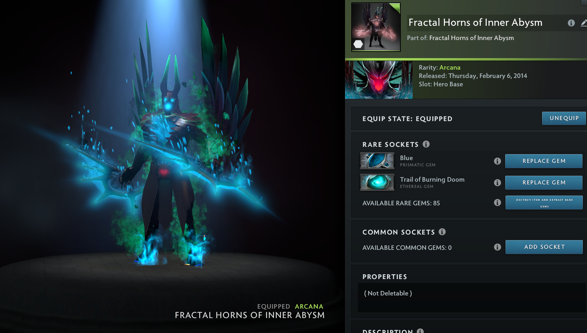
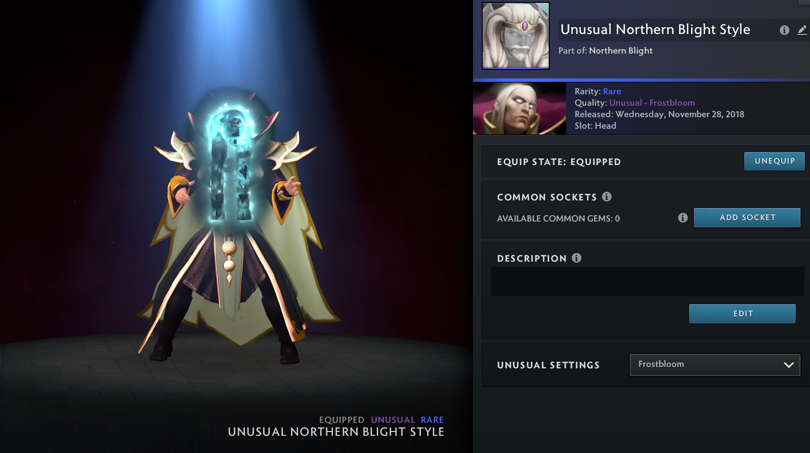
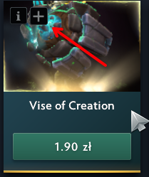

# ovr-skinchanger

Open-source internal Dota 2 skin changer for Windows.

## Features

- Any item added to the inventory and equipped from the hero loadout
- Styles unlocked, sockets, prismatic and ethereal gems
- Per-item unusual effect picker
- Items, arcana models and effects applied in matches

## Usage

Press the `+` button on an item tile to add it to the inventory:

## License

GPL-3.0
